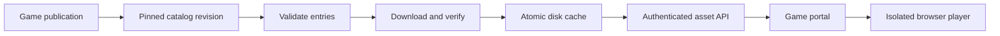

# Build a Game Preloader

A practical guide by **Carter (carteraccs)** to building a TypeScript game cache for a VPS. AI assistance helped prepare the documentation. Carter's production preloader remains private; this repository contains a standalone guide and small educational examples.

A preloader downloads published game files ahead of time, verifies them, caches them on disk, and delivers them to a browser game portal. Players still play in their browser. The service does not execute the downloaded games.

## Start here

1. Read [Architecture and implementation](docs/BUILD.md) to design your service.
2. Follow [Automatic publishing](docs/SYNC.md) to discover new games without editing a VPS manifest or restarting.
3. Use [Deployment and administration](docs/DEPLOY.md) to protect asset delivery and admin access.
4. Work through [Testing and troubleshooting](docs/TESTING.md) before connecting a real game library.

Use Node.js 22 or later, TypeScript, Git, and a Linux VPS. Bun is an optional development tool. Disk requirements depend on your library: budget for compressed games, temporary downloads, retained versions, and operating-system headroom.



## Try the integrity example

This repository is documentation, not a complete preloader service. The included example demonstrates how to calculate a SHA-1 Git blob ID for a file:

```bash
git clone https://github.com/carteraccs/carter-games-preloader-guide.git
cd carter-games-preloader-guide
node examples/hash-file.mjs examples/demo.html
git hash-object --no-filters examples/demo.html
```

Both commands should print the same value. For a SHA-256 Git repository, match that repository's object format instead of assuming SHA-1. Obtain expected hashes from a trusted, pinned catalog; a hash supplied by an untrusted download does not establish trust.

## What to implement

| Component | Responsibility |
| --- | --- |
| Catalog | Validate slugs, source paths, revisions, hashes, and size limits |
| Cache worker | Deduplicate downloads, bound concurrency, verify bytes, atomically save |
| Synchronizer | Poll a trusted source, reconcile revisions, retry failed updates |
| Asset API | Authenticate requests and serve only verified known versions |
| Status page | Show progress and resource metrics without credentials |
| Admin page | Protect operations with password hashing, expiring sessions, and CSRF checks |
| Browser player | Isolate third-party games from the portal's storage and credentials |

Use games you own or have permission to host. Keep creator credits and game licenses separate from your service's license.

## References

- [Git object hashing](https://git-scm.com/docs/git-hash-object)
- [Node.js cryptography](https://nodejs.org/api/crypto.html)
- [Bun installation](https://bun.sh/docs/installation)
- [systemd service configuration](https://www.freedesktop.org/software/systemd/man/latest/systemd.service.html)

The guide and its original examples are [MIT licensed](LICENSE).
